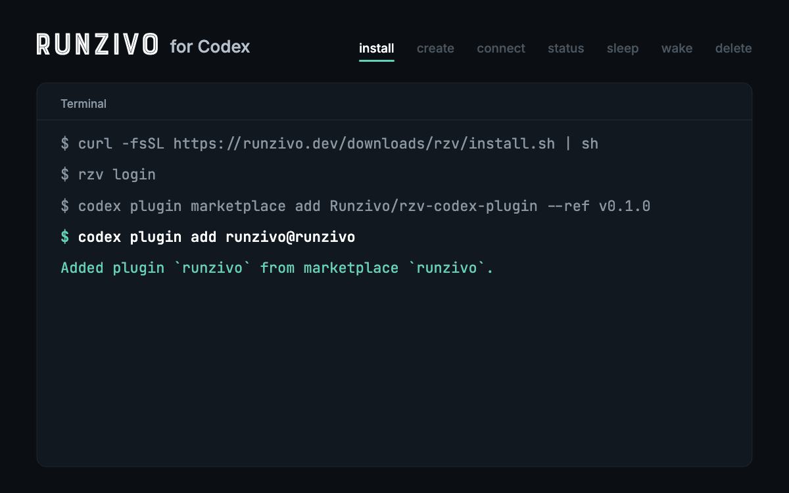

# Runzivo Sandboxes for Codex

A [Codex](https://developers.openai.com/codex) plugin for [Runzivo](https://runzivo.dev/sandboxes/) cloud sandboxes. Each sandbox is a Linux Firecracker microVM you reach over SSH. Ask Codex to create one, run work in it, check it, put it to sleep, wake it or delete it.

[](https://github.com/Runzivo/rzv-codex-plugin/actions/workflows/ci.yml) [](https://github.com/Runzivo/rzv-codex-plugin/releases/latest) [](LICENSE) [](https://runzivo.dev/sandboxes/)



The plugin is five skills. Each one runs the open-source [`rzv` CLI](https://github.com/Runzivo/rzv-cli) with your own Runzivo sign-in. It calls no API itself, stores no tokens and ships no AI provider keys.

## Install

You need `rzv` 0.26.0 or later, signed in:

```sh
curl -fsSL https://runzivo.dev/downloads/rzv/install.sh | sh
rzv login
```

Then add the plugin to Codex:

```sh
codex plugin marketplace add Runzivo/rzv-codex-plugin --ref v0.1.0
codex plugin add runzivo@runzivo
```

In the Codex app, open **Plugins**, choose the **Runzivo** marketplace and install **Runzivo Sandboxes**.

## Use

| Skill | Ask Codex |
| --- | --- |
| `$runzivo:create` | "Create a Runzivo sandbox, 4vcpu-16gb, 12h" |
| `$runzivo:connect` | "Run the tests in my Runzivo sandbox" |
| `$runzivo:status` | "How long does my Runzivo sandbox have left?" |
| `$runzivo:sleep-wake` | "Put my sandbox to sleep" / "Wake it" |
| `$runzivo:delete` | "Delete my Runzivo sandbox" (Codex asks you to confirm) |

Codex names the sandboxes it creates `codex-<slug>`. `rzv` needs network access, so approve it when Codex asks to run it outside its own sandbox.

## Docs

- [Skills and commands](docs/skills.md)
- [Security and privacy](docs/security.md)
- [Troubleshooting](docs/troubleshooting.md)
- [Testing](docs/testing.md) and [releasing](docs/releasing.md)

## License

MIT. See [LICENSE](LICENSE). `rzv` and the Runzivo service have their own licences and terms.
